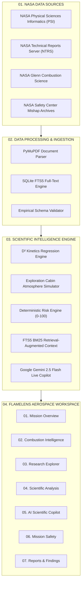

# 🚀 FlameLens AI — Microgravity Combustion Scientific Intelligence

[](https://www.spaceappschallenge.org/)
[](https://www.spaceappschallenge.org/2026/challenges/flame-in-freefall/)
[](#)
[](https://python.org)
[](https://fastapi.tiangolo.com)
[](https://react.dev)
[](https://www.typescriptlang.org/)
[](https://tailwindcss.com)
[](https://ai.google.dev/)

> **FlameLens AI** is an interactive scientific intelligence platform built for **NASA Space Apps Challenge 2026, Challenge 08: Flame in Freefall** by **Team QuantumX**.
>
> It synthesizes empirical microgravity combustion telemetry from the **International Space Station Combustion Integrated Rack (CIR)** and **NASA Glenn Research Center (GRC)** drop towers to rank, compare, and interpret flame kinetics for human space exploration fire safety.

---

## 🛰️ System Architecture



---

## 🔬 Core Capabilities

### 1. Mission Overview (`/`)
- **Authentic Microgravity Visualization:** Live inspection of pure spherical flame envelopes observed aboard the ISS CIR.
- **Physical Transport Comparison Matrix:** Side-by-side analysis of Earth normal gravity ($1\text{ g}$) vs microgravity ($10^{-6}\text{ g}$), distinguishing pure molecular diffusion from buoyant convection ($Gr \approx 0$).
- **Flight Telemetry HUD:** Real-time sync with 29 empirical NASA flight experiments across FLEX, FLEX-2, ACME, and CFI.

### 2. Combustion Intelligence (`/combustion`)
- **$D^2$ Droplet Kinetics Regression:** Automated linear regressions for droplet diameter decay:
  $$d^2(t) = d_0^2 - K \cdot t$$
  Calculates burning rate constant $K$ ($\text{mm}^2/\text{s}$), goodness-of-fit $R^2$, RMSE, and measurement uncertainty $\Delta K$.
- **Exploration Cabin Atmosphere Simulator:** Simulates hyperoxic ($34\%\text{ O}_2$) and hypobaric ($56.5\text{ kPa}$) exploration environments to compute Oxygen Partial Pressure $P_{\text{O}_2}$, Relative Flammability Index (RFI), and burning rate multipliers.
- **Flame Morphology & Flight Telemetry:** Explores extinction curves, standoff ratios, and soot shell radiation losses.

### 3. Research Explorer (`/library`)
- **Full-Text FTS5 BM25 Search:** Search across 30 peer-reviewed NASA publications and research datasets.
- **Taxonomy Filtering:** Filter by topic, institution (NASA Glenn, NASA Safety Center, Case Western, Princeton, UCSD), and flight mission series.
- **Document Detail Inspector:** Displays structured abstracts, methodologies, observations, DOI references, and verified links to official NASA archives.

### 4. Scientific Analysis (`/analysis`)
- **Multi-Run Cross-Comparison:** Compare 2 to 4 flight experiments simultaneously.
- **Multi-Variable Physical Matrix:** Cross-references 13 quantitative variables (burning rates, temperatures, soot yield, standoff ratio, LOI%).
- **Interactive Charting:** Comparative parameter distributions and delta evaluations.

### 5. AI Scientific Copilot (`/copilot`)
- **Truth-Grounded Intelligence:** Connects Google's Gemini 2.5 Flash with SQLite FTS5 BM25 retrieval to eliminate hallucinations.
- **Three Scientific Modes:**
  - `Mode A: Theory` — Combustion kinetics, cool flame transitions, radiative extinction.
  - `Mode B: Safety` — Cabin oxygen hazards, detector latency, Apollo 1/13 and Mir lessons.
  - `Mode C: Data` — $D^2$ regression parameters and physical delta calculations.
- **Real-Time SSE Streaming:** Chunked live responses with expandable peer-reviewed citation cards and source URLs.

### 6. Mission Safety Intelligence (`/safety`)
- **Deterministic Risk Scoring:** Ranks 29 materials & atmospheric conditions using:
  $$\text{Risk Score} = 0.35 \cdot F + 0.25 \cdot T + 0.20 \cdot S + 0.20 \cdot R$$
- **Sensor Evasion Physics:** Quantitative analysis on why traditional ceiling smoke detectors fail in microgravity without buoyant updraft.
- **Historical Spaceflight Mishaps:** Post-incident dossiers for Apollo 1 (1967), Apollo 13 (1970), and Mir (1997) with strict methodological isolation from controlled laboratory data.

### 7. Reports & Findings (`/reports`)
- **Publication-Grade Briefings:** Compiles selected flight runs, sensor tables, and flammability risk audits.
- **Export Options:** One-click Markdown (`.md`) download and Print/PDF export.

---

## 🛠️ Technology Stack

| Layer | Technology | Purpose |
| :--- | :--- | :--- |
| **Frontend Framework** | React 19 + Vite 8 + TypeScript | Aerospace mission control UI |
| **Styling** | Tailwind CSS v4 (`@theme` tokens) | Dark mission aesthetic (`#05090D`) |
| **Data Visualization** | Recharts 3.x | Scientific scatter, regression, and distribution charts |
| **Backend API** | Python 3.12 + FastAPI | Asynchronous REST & SSE endpoints |
| **Database & Search** | SQLite 3 + FTS5 BM25 | 29 verified experiments, 30 papers, 28 sources |
| **AI Copilot** | Google Gen AI SDK (Gemini 2.5 Flash) | Context-grounded scientific reasoning |
| **PDF Extraction** | PyMuPDF (fitz) | Automatic paper ingestion & metadata indexing |

---

## ⚡ Quick Start

### 1. Clone the Repository
```bash
git clone https://github.com/Fawadullah15/FlameLens-AI.git
cd FlameLens-AI
```

### 2. Backend Setup
```bash
cd backend
python -m venv venv
# On Windows:
.\venv\Scripts\activate
# On Linux/macOS:
source venv/bin/activate

pip install -r requirements.txt
```

Create a `backend/.env` file:
```env
GEMINI_API_KEY=your_gemini_api_key_here
GEMINI_MODEL=gemini-2.5-flash
ENVIRONMENT=production
```

Run backend server:
```bash
uvicorn main:app --reload --port 8000
```
Backend will be live at `http://localhost:8000` (API Docs at `http://localhost:8000/docs`).

### 3. Frontend Setup
```bash
cd ../frontend
npm install
npm run dev
```
Frontend will be live at `http://localhost:5173`.

### 4. Run Automated Tests
```bash
# Validate all 16 backend endpoints
python backend/tests/test_endpoints.py

# Validate live Gemini copilot & SSE streaming
python backend/tests/test_phase4_copilot.py
```

---

## 📜 Provenance & Official NASA References

- **NASA Physical Sciences Informatics (PSI):** [https://psi.nasa.gov/](https://psi.nasa.gov/)
- **NASA Glenn Research Center Combustion Science:** [https://www1.grc.nasa.gov/](https://www1.grc.nasa.gov/)
- **NASA Technical Reports Server (NTRS):** [https://ntrs.nasa.gov/](https://ntrs.nasa.gov/)
- **NASA Safety Center Mishap Archives:** [https://sma.nasa.gov/](https://sma.nasa.gov/)
- **FLEX & FLEX-2 Missions:** ISS Combustion Integrated Rack (CIR) Flight Data
- **NASA Space Apps Challenge 2026:** [https://www.spaceappschallenge.org/](https://www.spaceappschallenge.org/)

---

*FlameLens AI — Understanding Fire. Advancing Science. Protecting Future Space Missions.*  
*Developed by Team QuantumX for NASA Space Apps Challenge 2026.*
